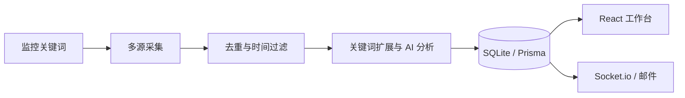

# Spring Breeze · AI 热点监控工作台

围绕自己关心的关键词收集信息，将分散的内容整理成可筛选、可排序、可追溯来源的热点列表。

这是一个 React + Express 全栈项目，覆盖关键词管理、定时采集、AI 相关性分析、SQLite 存储与实时通知，适合本地用于技术动态关注、选题辅助和信息整理。

## 功能

| 功能 | 说明 |
| --- | --- |
| 关键词管理 | 添加、启用、暂停和删除监控词 |
| 多源采集 | 搜索、社交与内容平台适配，统一结果结构 |
| 内容筛选 | 去重、新鲜度过滤、关键词扩展、相关性评分 |
| AI 摘要 | 摘要、重要性等级和相关性理由 |
| 工作台 | 按来源、关键词、时间和热度筛选排序 |
| 通知 | Socket.io 推送与可选 SMTP 邮件 |

**AI 输出是辅助判断。** `isReal` 等字段来自模型分析，不构成独立事实核验；重要信息应查看原始来源。第三方平台接口可能变化，不保证所有来源持续可用。



## 技术与目录

- **前端**：React 19、TypeScript、Vite、Tailwind CSS、Framer Motion。
- **后端**：Express 5、TypeScript、Prisma、SQLite、node-cron。
- **集成**：OpenRouter、Socket.io、Nodemailer。

```text
client/src/                  页面、筛选排序与 API 客户端
server/src/routes/           关键词、热点、通知与设置接口
server/src/services/         数据源、AI 与邮件服务
server/src/jobs/             定时采集处理流程
server/src/__tests__/        相关性与排序测试
server/prisma/              数据模型和迁移
docs/                       设计资料
skills/                     Agent 技能资料
```

建议从 [采集主链路](server/src/jobs/hotspotChecker.ts)、[AI 服务](server/src/services/ai.ts)、[数据模型](server/prisma/schema.prisma) 开始阅读。

## 本地运行

建议使用 **Node.js 22 LTS**。前后端各有独立锁文件，分别安装依赖：

```bash
git clone https://github.com/chifanjie/spring_breeze.git
cd spring_breeze/server
npm ci
```

将 `server/.env.example` 复制为 `server/.env`，填写自己的配置后：

```bash
npx prisma generate
npx prisma db push
npm run dev
```

另开终端启动前端：

```bash
cd spring_breeze/client
npm ci
npm run dev
```

打开 Vite 打印的本机地址，默认 `http://localhost:5173`。开发代理将 API 和 Socket 请求转发到后端 3001 端口。

先创建关键词，再在工作台触发检查。后端每 30 分钟执行定时检查；外部采集、模型调用和邮件受第三方费用、规则及限额约束。

### 配置

| 变量 | 用途 |
| --- | --- |
| `DATABASE_URL` | 本机 SQLite，示例为 `file:./dev.db` |
| `HOST` / `PORT` | 默认只监听 `127.0.0.1:3001` |
| `CLIENT_URL` | Socket.io 允许的前端来源 |
| `OPENROUTER_API_KEY` | AI 分析 |
| `TWITTER_API_KEY` | 可选数据源 API |
| `SMTP_HOST` / `SMTP_PORT` / `SMTP_SECURE` | 可选邮件服务器 |
| `SMTP_USER` / `SMTP_PASS` / `NOTIFY_EMAIL` | 邮件认证与接收地址 |

不提交 `.env`、SQLite 数据库或真实采集档案。无 API Key 不等于完整离线演示模式，不同服务的降级行为以代码为准。

## 检查与构建

```bash
cd server
npm test
npm run build
```

```bash
cd client
npm run build
```

2026-10-14 在 Windows 本地环境完成以下检查：

- 前后端分别执行 `npm ci --ignore-scripts`，Prisma Client 单独生成；前后端构建均通过。
- 后端测试结果为 **42 项通过、11 项跳过**；跳过项不计为通过。
- 使用全新临时 SQLite 初始化表结构，启动构建后的后端，仅监听 `127.0.0.1` 的临时端口。`GET /api/health` 返回 HTTP 200 和 `status: ok`，`GET /api/keywords` 返回 HTTP 200 和空数组，验证了监听、路由与数据库读取。
- 烟测没有创建监控词，没有触发采集、AI 或邮件调用。测试后停止临时服务，并确认进程退出、端口关闭。

本机直接对新数据库路径执行 `prisma db push` 曾返回无细节的 `Schema engine error`；烟测改用系统临时目录中预先创建的空 SQLite 文件，再同步表结构后成功，首次失败原因尚未定位。这不代表任意 Windows 路径的首次建库流程已经验证。

测试主要覆盖相关性与排序；以上本地检查不能替代外部平台、真实模型、邮件或完整浏览器交互的端到端验收。前端开发代理不是生产部署配置，独立部署构建产物需另外配置 API 和 Socket 转发。

## 当前范围与来源

- 定位为本机单用户工具，HTTP API 尚无完整用户认证和权限隔离，不应直接暴露到公网。
- 数据源、抓取规则及模型输出可能变化，需要持续维护。
- 模型重要性或可信度分数不是客观真值，这里没有声明准确率。
- 本次公开整理不使用真实第三方账号进行联网验收，源码存在不等于线上服务稳定运行。
- 维护者：[chifanjie](https://github.com/chifanjie)。第三方依赖及 UI 组件保留各自来源和许可；后端包元数据声明 ISC，其他内容未新增统一授权声明。

反馈请附复现步骤与脱敏日志。
